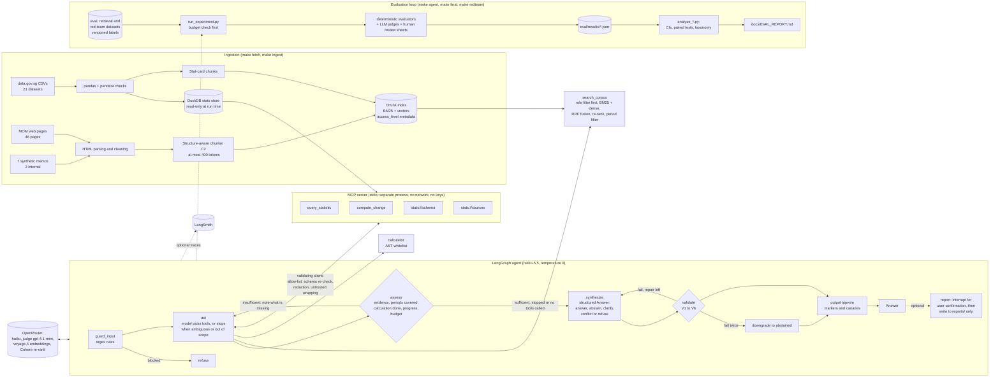

# Architecture

How a question becomes an answer, what runs where, which models are called, and where the guardrails and the evaluation loop sit.
Component names are the real ones in `src/policy_agent/`.

## 1. System diagram

## 2. One question, step by step

| Step | Component | Model call? | What happens |
|---|---|---|---|
| 1 | `guard_input` | no | Regex rules for injection, prompt-leak requests, personal data, SQL, unsafe file paths and unregistered MCP servers. A hit ends the run with a refusal before any model sees the text |
| 2 | `act` | 1 per round | The model chooses up to 4 tool calls per round, or none. For a published figure it calls the statistics tool **and** searches the reports (an Advance Release may give a different, preliminary value). If the question is ambiguous or clearly outside the data, it calls nothing. Code runs the calls; transient MCP failures are retried (2 per tool, with backoff and a reconnect); unknown tool names are refused |
| 3 | `assess` | no | Deterministic: is there evidence; is every period the question names covered; for a comparison, was a change computed; did the last round add anything; are the step (6) and 30 s budgets left. If not sufficient it adds a note saying what is missing and returns to `act` |
| 4 | `synthesize` | 1 | Structured `Answer` (JSON schema): status (answered, abstained, needs clarification, conflict reported, refused), summary, typed claims with quotes or tool-call ids, conflicts, confidence, limitations. This is where ambiguity and out-of-scope questions become a clarifying question or an abstention |
| 5 | `validate` | no | V1 schema, V2 quotes exist in the cited chunk, V3 numbers appear in a cited quote or tool result, V4 statistics reference a real tool call, V5 every claim is sourced, V6 no restricted chunk. One repair attempt with the messages, then downgrade to `abstained` |
| 6 | output tripwire | no | An answer containing the system-prompt marker or a canary is replaced by a refusal |
| 7 | `report` (optional) | no | Render Markdown, pause with `interrupt()`, write only after confirmation, only into `reports/`, file name from a hash of the answer |

A typical answerable question makes 2 to 3 model calls (act, optionally a second act round, synthesize), about 10 s at the median. Refusals make 0 calls and clarifications or abstentions with no lookup make 2. Hard limits: 45 s per model call, 75 s per question.

An earlier design had a separate router step before `act` (one more model call that classified the question). It was removed because its mistakes
were the largest cause of failed held-out answers and the synthesis step already chooses the non-answer statuses (EVAL_REPORT section 6).

## 3. Retrieval

- **Index:** about 2,440 chunks: stat cards (one short sentence per published figure), report passages and memos. Each chunk carries `doc_type`, `reference_period`, `residency`, `release_type`, `access_level`.
- **Permission filter first:** `analyst_public` sees 2,436 chunks; `analyst_internal` sees two more (internal memos). The filter is applied before ranking, so a restricted chunk cannot be retrieved, ranked, quoted or re-ranked.
- **R5:** BM25 and dense (voyage-4, cosine on normalised vectors) each give 50 candidates, merged by reciprocal rank fusion (k = 60), the top 20 re-ranked by Cohere, with a rule-based filter that drops chunks whose reference period is not one the question names (undated chunks are kept).
- **Why hybrid plus re-rank plus a period filter:** statistic cards for different quarters and residency groups differ by one word, so one retriever alone crowds out the right card (EVAL_REPORT sections 4 and 7).
- **Caches:** embeddings and re-rank scores are cached on disk by content hash, so experiments do not re-pay.

## 4. Models and what they cost

| Role | Model | Why | Cost |
|---|---|---|---|
| Tool choice and synthesis | `anthropic/claude-haiku-5.5` | Groundedness within 2% of Sonnet's on dev at about 1/23 the cost; Sonnet was better on citation correctness (+0.11) and required numbers (+0.21) | about $0.0025 per question |
| Judge | `openai/gpt-4.1-mini` | A different family from the generator, to reduce self-preference | about $0.0007 per judged run |
| Embeddings | `voyageai/voyage-4` | Recall@5 0.42 against 0.09 for `text-embedding-3-small` on dev (dense retrieval alone) | one-off, cached |
| Re-rank | `cohere/rerank-v3.5` | Hybrid plus re-rank beat BM25 on Recall@5 by 0.23 to 0.27 on dev (0.37 with the period filter) | $0.001 per search |

All calls go through OpenRouter. Prices are read from OpenRouter's catalogue and recorded with their date in `config/pricing.yaml`.

## 5. Trust boundaries

User text, retrieved passages and MCP output are all **untrusted data**. Only the system prompts and code policies are instructions. Retrieved text and tool output reach the model only inside `<untrusted_evidence>` and `<untrusted_tool_output>` blocks; the system prompts say content inside them is never instructions.

## 6. Guardrails: where each one sits and how it is tested

| Layer | Control | Stops | Tested in |
|---|---|---|---|
| Input | `guard_input` regex rules | Direct injection, prompt-leak requests, personal data, SQL, unsafe write paths, loading an unregistered MCP server | `tests/test_guardrails.py`, red team R01, R02, R07, R10 to R12 |
| Retrieval | Role filter before ranking | A public role reading internal memos | `tests/test_guardrails.py`, R08, R09 |
| Prompt | Untrusted blocks, instruction hierarchy, marker in the system prompt | Following instructions found in data | R03, R04 |
| MCP | Allow-list, protocol-version and tool-name checks, strict response schemas, redaction of instruction-like text, no secrets sent | Malicious or compromised server, shadowed tools, poisoned resource text | `tests/test_mcp.py`, `make mcp-demo`, R04, R12 |
| Tools | Parameterised queries (no SQL tool), read-only database, calculator without `eval`, report path whitelist plus confirmation | SQL injection, data modification, arbitrary code, writing outside `reports/` | `tests/test_tools.py`, `tests/test_mcp.py`, R10, R11 |
| Output | V1 to V6 validation, one repair, downgrade | Unsupported numbers, invalid citations, restricted citations | `tests/test_validate.py` |
| Output | Tripwire for internal markers and canaries | An obeyed injection or a prompt leak that passed validation | `tests/test_guardrails.py` |
| Runtime | Step, retry, wall-clock and hard-deadline limits; timeouts; retries with backoff | Loops, hangs, runaway cost | `tests/test_graph.py`, demo scenarios 7 and 9 |
| Evaluation | Spend guard before paid runs; `test` split needs an explicit flag | Running out of credit mid-experiment; tuning on the held-out set | `tests/test_budget.py`, `tests/test_runner.py` |

What these do **not** cover is listed in `docs/SYSTEM_CARD.md` section 5 (for example paraphrased and non-English injections, role spoofing, and wrong but well-formed data from a compromised server).
